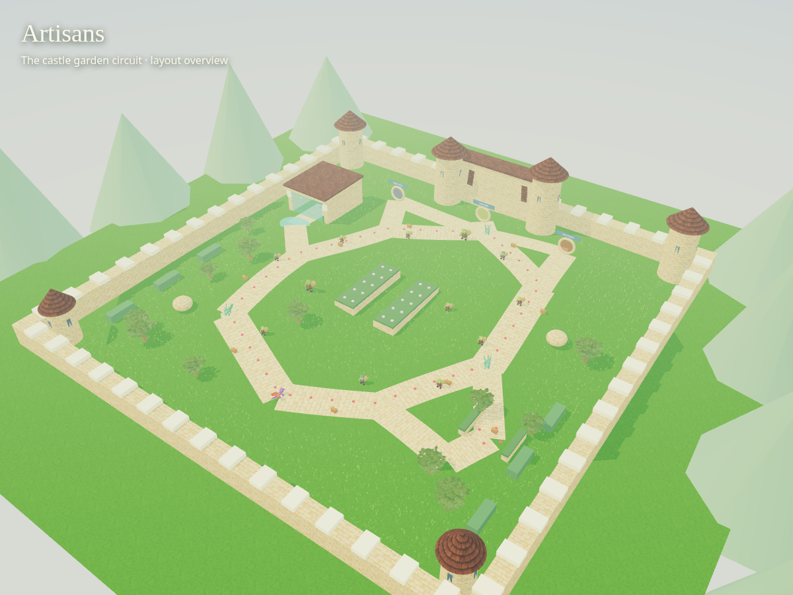
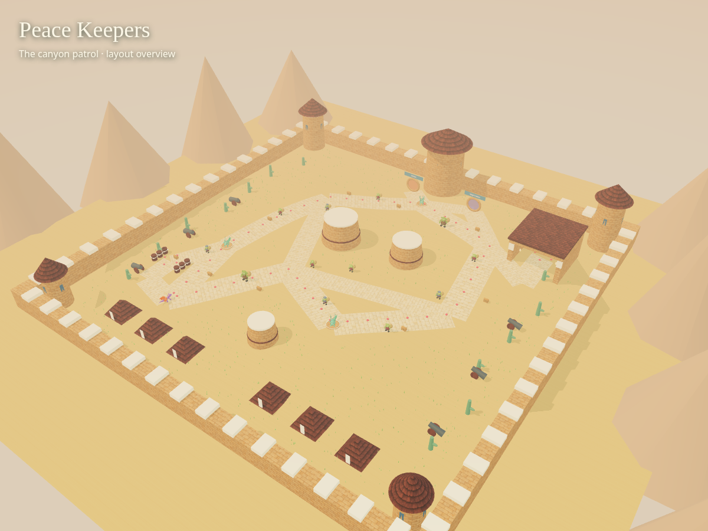
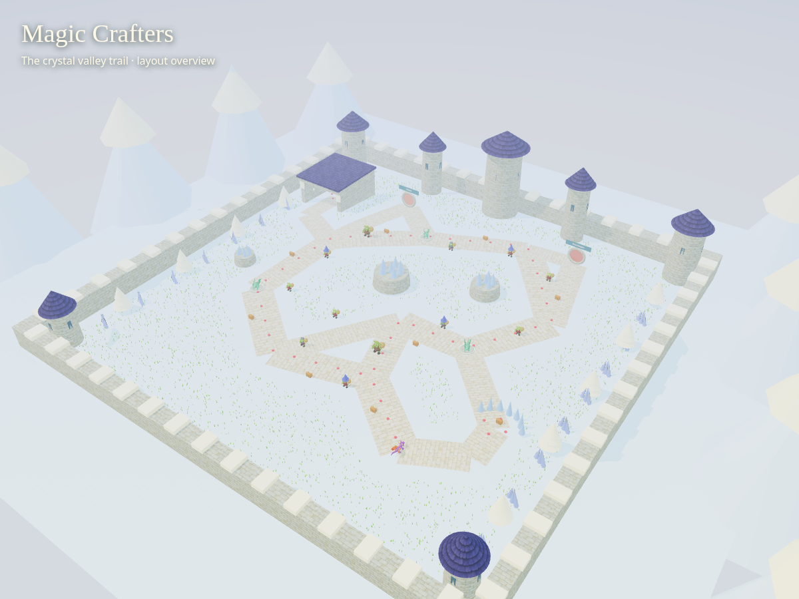
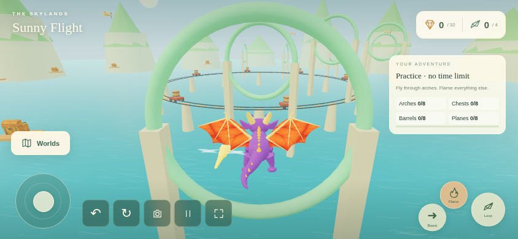

# Ground-land layout review

The live site remains on the published high-definition art/movement polish release. These new layouts are saved on the `distinct-land-loops` review branch and await visual approval before publication.

Each ground land has a different main exploration circuit, its own hills and objective positions, two optional treasure pockets and wide paths. The main route alone reaches all three friends and enough gems for the medal. Existing saves retain progress.

## Artisans

A castle-garden circuit passes an orchard, central planted beds, the castle court and waterfall trail. Optional discoveries: Waterfall Grotto and Orchard Cache.

[Actual phone view](layout-world-artisans.png) · [Waterfall Grotto](layout-secret-waterfall-grotto.png) · [Orchard Cache](layout-secret-orchard-cache.png) · [Native phone discovery](layout-phone-secret-artisans.png)

## Peace Keepers

A canyon patrol loops around sandstone mesas, with a cross-route through the training field and a camp spur. Optional discoveries: Canyon Cache and Camp Stores.

[Actual phone view](layout-world-peace-keepers.png) · [Canyon Cache](layout-secret-canyon-cache.png) · [Camp Stores](layout-secret-camp-stores.png) · [Native phone discovery](layout-phone-secret-peace-keepers.png)

## Magic Crafters

A winding valley connects snowy hollows, crystal formations and the wizard court. A central shortcut and wide hillside trail create return loops. Optional discoveries: Frozen Observatory and Moonstone Overlook.

[Actual phone view](layout-world-magic-crafters.png) · [Frozen Observatory](layout-secret-frozen-observatory.png) · [Moonstone Overlook](layout-secret-moonstone-overlook.png) · [Native phone discovery](layout-phone-secret-magic-crafters.png)

## Sunny Flight

The flying course is unchanged in this pass. Its actual phone campaign controls, pause/retry and timer checks passed again.

Overviews and pocket close-ups use the same game renderer, loaded models, textures and authored world data, with review cameras on a test-only page. Phone views come from the running game. See [verification](verification.md) for functional checks and device-testing limits.
