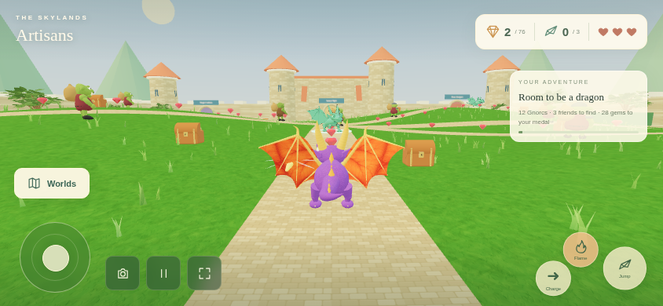
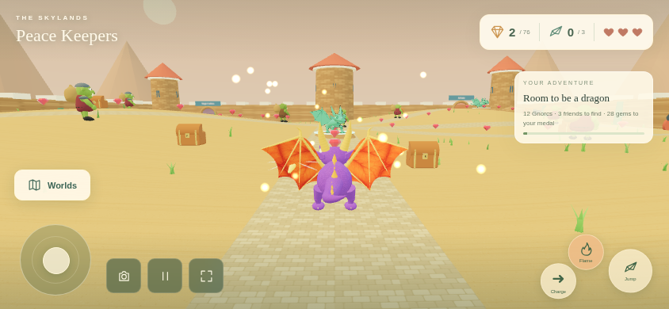
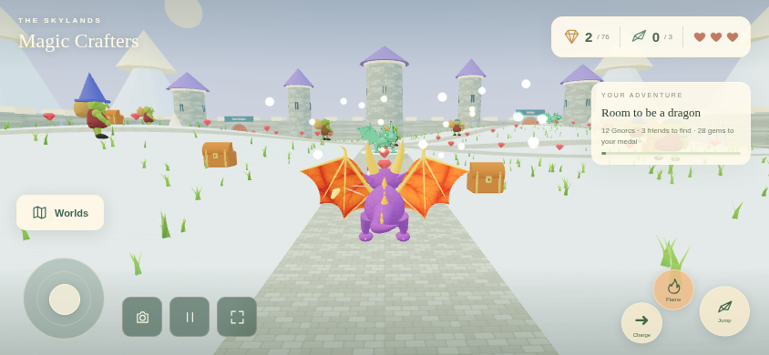
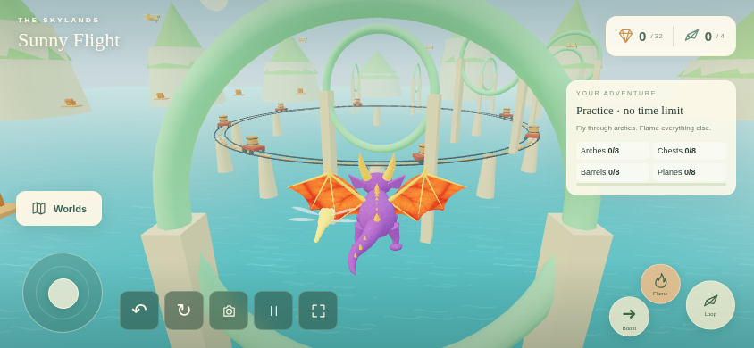

# World screenshot review

Status: awaiting the user's visual approval. These are actual 844 × 390 phone-browser captures of the review build, with transient messages cleared.

The three ground lands have continuous rolling hills, gently sloping paths and visible enclosing walls. Every destination is open from the start. Sunny Flight is a separate full-flight coastal course with untimed practice by default.

## Artisans

## Peace Keepers

## Magic Crafters

## Sunny Flight

Review notes and any requested changes will be recorded before this upgrade is called complete.
